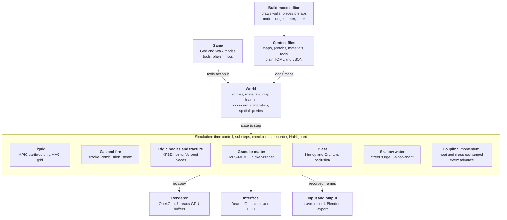

# ENTROPY — Engine & Game Specification

> Living document: https://claude.ai/artifact/RK3rxXqXVz6rBX78kGedLc — exported here on 2026-11-20. Since then this file is the reference (ADR 0006): it changes through pull requests, and changes Matt makes in the living document are brought here by the maintainer when he reports them.

## 1. Vision & pillars

ENTROPY is a real-time 3D physics sandbox where water, fire, smoke, explosions and destructible structures obey physical laws and act on each other, at the scale of one house. It is a playground for causing disasters and watching them unfold, not a game with objectives.

The dream in one sentence: flood a house, set it on fire, blow it up, and watch every drop, flame and brick behave as it would in reality.

Five pillars, in priority order:

1. **Measurable realism.** Every solver uses a published method, works in SI units and is validated against analytical solutions or laboratory experiments (section 9). Looking real is not enough: behaviour must match a reference within a stated tolerance.
2. **Everything interacts.** Water puts out fire, fire weakens beams, blasts throw debris, debris floats or sinks. Two-way coupling is a core feature, not an add-on (section 6).
3. **Real-time play.** At least 30 fps on the target laptop in typical scenes, with instant response to tools. When realism and frame rate conflict, resolution drops before physics is faked.
4. **Joy of destruction.** Chaos is one click away. Pause, slow motion, checkpoints and cinematic replays make every disaster worth watching twice.
5. **Built to grow.** Maps, props, materials and tools are content files, not code. A built-in Build mode lets anyone make maps without 3D skills, and every solver and tool sits behind a stable interface, so features are added without rewiring the engine (sections 4 and 8).

The realism ceiling is stated honestly. Detail finer than the simulation grid (spray droplets, thin liquid sheets, millimetre flame structure) is approximated by secondary particles and shading, as in film VFX.

## 2. Scope

Version 1.0 is a single-player sandbox for Windows and NVIDIA GPUs, covering one house in full detail and a street of houses for the surge wave.

**In scope (v1.0)**

- Liquid: water, with free surface, splashes and secondary foam and spray.
- Gas: air, smoke, steam, combustion and fire, with oxygen tracking.
- Solids: rigid bodies, fracture of brittle and quasi-brittle materials (glass, brick, concrete, wood, plaster), structural collapse.
- Granular matter: rubble, dust, sand and soil.
- Explosions: condensed charges (TNT-equivalent) and flammable gas clouds.
- Combustion of building materials: ignition, flame spread, charring and loss of strength.
- Large-scale water: a shallow-water surge (tsunami, flood) across a street, coupled to the detailed 3D water around the house.
- Three modes: God (free camera), Walk (first person) and Build (map editor).
- Map system: human-readable map files, prefabs, procedural generators and an in-game editor.
- Time control: pause, slow motion, single step, checkpoints.
- Recording and export of a sequence for an offline cinematic render in Blender.

**Out of scope (v1.0)**

- Multiplayer, consoles, macOS, Linux builds, AMD or Intel GPUs, VR.
- City-scale 3D simulation (the street uses a 2D shallow-water model away from the house).
- Compressible shock-wave simulation (blasts use a validated empirical model, section 5.7).
- Detailed combustion chemistry (one-step reaction model).
- Cloth, soft bodies, characters, ragdolls and vehicles.
- Physically synthesized sound (v1.0 plays recorded samples driven by physics events).
- A public modding API (content files are open and documented, but not a stable public contract).

Future ideas, not committed: earthquakes, lava, tornadoes, vehicles, ragdolls, viscous liquids such as oil and mud.

## 3. Target platform & performance budgets

The game targets one machine: a Dell Precision 7780 laptop with an RTX 4090 Laptop GPU, running natively on Windows, plugged in, in performance power mode, with the Dell thermal profile *Optimized*. A typical scene must hold at least 30 fps, sustained after thermal warm-up.

| Component | Specification |
| --- | --- |
| GPU | NVIDIA RTX 4090 Laptop, 16 GB VRAM (same AD103 chip as the desktop RTX 4080, power-limited) |
| CPU | Intel Core i9-13950HX |
| RAM | 64 GB |
| Storage | 2 TB SSD |
| OS | Windows, native. WSL2 is not a supported runtime (GPU and OpenGL interop to verify in M0) |
| Display | 1920 × 1080 render target, with internal resolution scaling |

**Frame budget at 30 fps (33.3 ms)**

| Stage | Budget (ms) |
| --- | --- |
| Simulation, all solvers and coupling | 22 |
| Rendering | 9 |
| Game logic, UI and Python orchestration | 2 |
| Margin | 0.3 |

**Solver capacities**

Recalibrated by the M0 measurements (`docs/benchmarks/2026-11-20-m0-laptop.md`, `docs/benchmarks/2026-11-20-m0-gate.md`); later milestones measure each solver against its row. A house of 10 × 8 × 6 m at the 6.25 cm liquid cell size is 160 × 128 × 96 ≈ 2.0 million cells, so the whole house fits in the liquid grid.

| Solver | Capacity | Time budget (ms) |
| --- | --- | --- |
| Liquid (APIC/FLIP) | 1–2 million particles, ≤ 2 million active cells at 6.25 cm. At risk: the pressure solve on the full house grid is estimated at 5.0–8.7 ms per substep with constant coefficients and 7.1–12.7 ms with the variational weights of rigid-body coupling (section 5.2), times the CFL substeps (2 for water at 2 m/s at 30 fps, so 10–25 ms per frame). Measured in M1 (official, `docs/benchmarks/2026-11-22-m1-laptop.md`): in the game at 1 M particles in the Test Tank, the simulation stage's GPU span is 6.8 ms per frame at one substep (pressure from the last pressure 3.4 ms, 8 iterations; transfers 1.7 ms) and 23.1 ms at four substeps under the hose's 10 m/s jet, above the whole 22 ms simulation budget, the world then running at 0.93–0.95× real time (unofficial); so the budget holds at one substep only, and the gate's hose part keeps about 5 fps above 30 (p10 35.0 fps officially, ADR 0029, #81). Transfers sorted by half-cell (ADR 0025): 1.16 ms per substep, plus 0.25 ms of sorting per frame (random order: 4.7 ms). The pressure solve from zero after a relabel: 4.4 ms per substep on the Test Tank grid, 18.0 ms on the full house grid, 2.1 to 3.6 times the estimate. At risk: fast water's four substeps and the house grid's solve, to bring down before M3 shares the GPU | 9 |
| Gas, smoke and fire | Target 96³ to 128³ cells in a moving box, 5–10 cm cells. At risk: estimated 3.7–6.1 ms per substep at 96³ and 7.6–13.5 ms at 128³, times 1–4 CFL substeps per frame; a 0.5–1 MW furniture fire rises at 6.7–7.7 m/s (McCaffrey), which needs 3–4 substeps in 7.5 cm cells at 30 fps; 192³ is out of reach (≈ 44 ms). The M1 pressure solver alone measured 14.7 ms per substep from zero at 128³ (ADR 0016, unofficial) and 20.0 ms officially after the warm-up (`docs/benchmarks/2026-11-22-m1-laptop.md`), above the 7.6–13.5 ms estimated for the whole gas step. M3 decides box size, gas substeps and pressure solve frequency | 6 |
| Rigid bodies and fracture | 5,000 bodies, 20,000 bonds (not measured in M0; checked in M2) | 3 |
| Granular (MPM) | 300,000 particles (not measured in M0; checked in M4) | 2 |
| Shallow water (street, M8) | 1024 × 1024 cells at 25 cm; about 0.23 ms per step by bandwidth bound, and a 4 m surge needs about 7 steps per 1/30 s frame (Δt ≤ Δx/4a with a = |u| + √(gh), the CFL limit of Kurganov & Petrova's 2D scheme), so about 1.6 ms per frame: at risk, M8 decides | 1 |
| Blast model and coupling | analytic, per event (checked in M5) | 1 |

**Measured hardware limits (M0)**

Matt confirmed on 2026-11-21, after the M0 sessions, that the Dell thermal profile is *Optimized*. It was not recorded during them and there is no sign it was changed, so the limits are taken to apply to that profile. A higher profile (*Ultra Performance*) may raise the power limit; it is not measured and nothing is budgeted on it.

- Planning bandwidth (estimate): 450 GB/s for read-write streaming in the sustained state, the 503 GB/s copy measured at the full 9001 MHz memory clock scaled to the 8001 MHz seen under the power cap (the 192³ streaming pass measured 462 GB/s during a run in which the memory clock fell to 8001 MHz). A kernel moving B bytes per cell over N cells costs at least B·N / 450 GB/s. Grids that fit in the 64 MiB L2 cache run up to twice as fast; solvers with many live fields should not count on it.
- Sustained GPU state after warm-up, over the two M0 sessions: 82–93 °C, enforced power limit 110–122 W, thermal and power capped; SM clock 1.05–2.3 GHz, memory clock 7001–9001 MHz (7001 MHz seen once, at the start of a benchmark). Estimates use the DRAM rate of 28 ps per cell per sweep for planning and each grid's slower L2 rate (house 15.0 ps, 128³ 15.2 ps) as the optimistic end.
- A kernel launched from Python costs about 15 µs of CPU time (measured), so solver frames launch their kernels from CUDA graphs only (median 0.2–0.7 µs of CPU per kernel depending on graph size, up to 1.1 µs at p90 for large graphs): at most about 1,800 graph kernels per frame on the CPU side if launches had the whole 2 ms orchestration budget, which they share with game logic and the interface. Iterative solver loops replay as CUDA graphs in fixed batches, with one read-back per batch (the M1 pressure solver: batches of 4 iterations, about 4 synchronisations per solve, ADR 0016), so CPU launches grow only by one graph launch per batch. Conditional graph nodes would remove the read-backs, at about 4–5 µs of GPU time per iteration (measured, unofficial, ADR 0026); the pressure solve keeps its batches while it converges in 4–8 iterations. On the GPU every executed kernel costs about 1.2 µs on top of its work (measured on tiny kernels; estimate for others) and is counted in the solver's budget (2,000 kernels = 2.4 ms).
- CPU and GPU work concurrently (reasoned, measured from M1): Python enqueues while the GPU runs earlier work, so the orchestration budget is the CPU time the GPU has to wait for: synchronisation points such as CUDA–OpenGL map and unmap, read-backs, and OpenGL and interface calls on the same thread.

**Memory budgets**

- VRAM: at most 12 GB used by ENTROPY, leaving 4 GB for the driver, Windows and the display.
- Host RAM: at most 24 GB, checkpoints included.
- Scene load: at most 10 s for the house map.

Performance is measured, never assumed. Every budget above has a benchmark (section 9) that runs on the laptop after a 5-minute warm-up, so thermal throttling is included in the numbers.

## 4. Game design

ENTROPY has three modes over one world: God to cause disasters, Walk to live them from inside, and Build to make maps. God and Walk share the running simulation; Build edits the map's initial state and Play runs it.

### 4.1 Modes

| Mode | Camera | Purpose | Simulation |
| --- | --- | --- | --- |
| God | Free flight, orbit around the cursor | Trigger and watch disasters, inspect anything | Running |
| Walk | First person, physical capsule 1.8 m tall, 80 kg | Live the disaster from inside; water and blasts push the player | Running |
| Build | Free flight with grid snapping | Create and edit maps | Stopped at the map's initial state; Play launches it |

Switching between God and Walk keeps the simulation exactly as it is. The player is immortal by default (see section 13 for an optional mortal mode).

### 4.2 Tools

Every tool exposes its parameters in SI units, so the player always knows what is being thrown at the world.

| Tool | Effect | Parameters | Milestone |
| --- | --- | --- | --- |
| Hose | Water jet | flow 1–50 L/s, nozzle speed 5–30 m/s | M1 |
| Bucket | Drops a volume of water: a block, or a dam column against the far wall (right click) | 0.01–2 m³ | M1 |
| Flood source | Inflow over the tank's whole floor that raises the water level (in M1 the water comes in at the level it stands at, a named simplification) | 0.01–5 m³/s | M1 |
| Eraser | Removes an object, or liquid or gas in a radius | radius 0.1–5 m | M1 |
| Spawner | Drops props: crate, barrel, furniture, blocks | prop, material, size | M2 |
| Grabber | Picks up, carries and throws objects | up to 500 kg | M2 |
| Lighter | Ignites a point | — | M3 |
| Flamethrower | Jet of burning fuel | 0.01–0.5 kg/s | M3 |
| Wind | Global wind or local fan | 0–30 m/s | M3 |
| Sledgehammer | Impact at a point | 50–500 J | M4 |
| Launcher | Fires projectiles | 1–100 kg at 10–300 m/s | M4 |
| Wrecking ball | Ball hung from a crane | 500–5,000 kg | M4 |
| Explosive charge | Placed, then fired by timer, remote or chain | 0.05–20 kg TNT-equivalent | M5 |
| Gas leak | Releases flammable gas (propane) | 0.001–0.1 kg/s | M5 |
| Surge wave | Tsunami-style surge entering the street | height 0.5–8 m | M8 |

Tools are plug-ins: a new tool is one class implementing the tool interface plus one content file for its parameters and icon (section 8).

In M1, water thrown from outside the liquid's grid (the hose, from the camera) flies ballistically, without drag, until it enters the tank over its rim; water that hits the glass below the rim or the ground is lost, since water cannot exist outside the tank yet (ADR 0017, ADR 0020). Sources carry the fraction of a particle they could not release to the next frame, so slow motion loses no water.

### 4.3 Maps and Build mode

A map is a folder of plain text files under version control, so maps can be diffed, copied, shared and repaired by hand.

- `map.toml` holds metadata, `schema_version` and the environment: gravity, air temperature, wind, sea level, time of day.
- `scene.json` holds the placed entities: prefab id, transform, material and parameters.
- Old maps load forever: the loader migrates any older `schema_version` automatically, and every migration has a test.

Maps are assembled from parametric prefabs, so nobody needs 3D modelling skills:

- **Structure:** wall (length, height, thickness, openings), floor slab, beam, column, roof, stairs.
- **Openings:** door, window (glass pane and frame).
- **Furniture:** table, chair, sofa, bed, shelf, cabinet, curtains.
- **Props:** crate, barrel, gas bottle, concrete block, car-sized block.
- **Sources:** water inlet, gas leak, fire start, explosive charge placed in advance.

Build mode tools:

- Draw walls by clicking corners; openings are cut automatically.
- Place, move, rotate and scale with a 12.5 cm snap grid (two liquid cells).
- Paint materials, duplicate, delete, with unlimited undo and redo.
- A budget meter estimates cells, particles and bodies for the map and warns before a budget in section 3 is exceeded.
- A map linter flags unsupported structures and overlapping solids before Play.

Procedural generators produce ordinary, editable maps: a house generator (floors, rooms, style, furniture density) and a street generator (number of houses, slope to the sea). Importing external glTF 2.0 props, with automatic collision and fracture preparation, is a stretch goal for M9.

### 4.4 Maps shipped with v1.0

| Map | Content | Milestone |
| --- | --- | --- |
| Test Tank | 4 × 4 × 2 m glass tank on a concrete floor | M1 |
| Room | 5 × 4 × 2.7 m room with a door, a window and furniture | M2–M5 |
| House | Two-storey furnished house, 10 × 8 × 6 m | M6 |
| Street | Six houses along a street sloping down to the sea | M8 |

### 4.5 Controls

Keys below are positions on a QWERTY keyboard (W A S D is Z Q S D on AZERTY). Every key is set in the `[controls]` table of `content/settings.toml` by the label printed on the player's keyboard (ADR 0012).

| Action | Input |
| --- | --- |
| Move | W A S D; Space and Ctrl for up and down in God and Build; Space jumps in Walk |
| Look | Mouse, after a click in the window; Esc gives the mouse back |
| Use tool | Left click, held for continuous tools |
| Tool alternate action | Right click |
| Tool power | Mouse wheel |
| Choose tool | Q for the radial menu, or 1–9 |
| Switch God and Walk | Tab |
| Build mode | B |
| Pause | P |
| Slow motion | \[ and \] cycle 1×, 0.5×, 0.25×, 0.1× (the slowest: float32 positions, ADR 0026) |
| Single step while paused | . (period) |
| Checkpoint save and restore | F5 and F9 |
| Record a sequence for Blender | F10 |
| Screenshot | F12 |
| Performance HUD | F3 |
| Menu | Esc |

### 4.6 Time control, checkpoints and recording

- Slow motion advances less simulated time per frame, every frame, and costs less per frame (ADR 0008). Solvers take smaller CFL substeps, so they take more substeps per simulated second; advection and particle–grid transfers lose a little at each, so slow motion is slightly more dissipative (smoke a little blurrier), not identical (ADR 0013).
- The camera stays free while paused, to inspect a frozen explosion from every side.
- Checkpoints copy the full simulation state to host memory asynchronously: automatically every 10 s (ring of 6), at the start, and on F5. F9 restores the latest; pressing it again goes one further back. They keep in step with the NaN guard (ADR 0024): a checkpoint saved after the last step is checked before it can be restored, F5 does nothing while the world is frozen, and water in flight outside the grid is not saved (a named simplification).
- A re-run from a checkpoint is not bit-identical on the GPU (section 9.6). Small divergence is expected and harmless.
- Recording (F10) streams render-relevant state to disk every frame for the Blender export (section 7.4).

### 4.7 Interface

The interface is a Dear ImGui overlay:

- Tool palette with parameters in SI units.
- Performance HUD: fps, milliseconds per solver, particle, cell and body counts, VRAM use.
- Inspector: click any object to read its material, mass, temperature and damage.
- Build panels: prefab library, properties, layers, budget meter.

### 4.8 User stories

Each story is accepted only when its criteria pass as automated tests and Matt has played it.

| ID | Story | Acceptance criteria | Milestone |
| --- | --- | --- | --- |
| US-01 | First splash | In Test Tank, 10 s of hose at 20 L/s puts 200 L ± 2 % of water in the tank, at ≥ 30 fps | M1 |
| US-02 | Dam break | A released water column advances like Martin & Moyce's experiment (test V-LIQ-03) | M1 |
| US-03 | Slow motion | At 0.1× the camera moves freely, and a scenario run at 0.1× matches the same scenario at 1× in simulated time: a dam break run at both speeds meets V-LIQ-03, keeps its volume within V-LIQ-02's 1 %, and the two fronts agree within 4 % at the same simulated instants (ADR 0008, ADR 0013, ADR 0028) | M1 |
| US-04 | It floats | A wooden crate (600 kg/m³) settles 60 % ± 5 % submerged; a concrete block sinks | M2 |
| US-05 | Wading | In Walk mode, water 0.5 m deep flowing at 1 m/s pushes the player | M2 |
| US-06 | Light it up | An ignited wooden table burns; smoke fills the ceiling layer first, then descends | M3 |
| US-07 | Put it out | Hosing a burning object stops the flames, and it does not reignite while wet | M3 |
| US-08 | Smash | A sledgehammer blow shatters a glass pane into falling shards; a brick wall needs repeated blows | M4 |
| US-09 | Boom | A 1 kg charge in the Room throws debris, makes a fireball and smoke; windows break only above their overpressure threshold | M5 |
| US-10 | Collapse | Destroying the ground-floor load-bearing walls brings the upper floor down under its own weight | M6 |
| US-11 | Burn down | A fire left alone spreads through combustible materials; burnt beams lose strength and can fail | M6 |
| US-12 | Backdraft (stretch) | A fire starved of oxygen flares up when a door is opened | M6 |
| US-13 | Build a room | In Build mode, Matt draws four walls, adds a door, a window and furniture, and presses Play in under 5 minutes, without editing a file | M6 |
| US-14 | Generate a house | The generator makes a furnished house that can be edited and saved like any map | M6 |
| US-15 | Share a map | A saved map folder copied to another install loads identically | M6 |
| US-16 | Movie replay | A 10 s recording exports to Blender and renders with Cycles from a single command | M7 |
| US-17 | Tsunami | A 4 m surge floods the street, enters houses through doors and windows and carries debris | M8 |

## 5. Physical model

Each phenomenon uses a published method in SI units, and each method has validation tests listed in section 9.4. Where real-time limits force a simplification, the simplification is named here, never hidden.

### 5.1 Conventions

- Units are SI: metre, kilogram, second, kelvin, pascal, joule. The interface shows °C; storage is in kelvin.
- The frame is right-handed with Z up, as in Blender, so exports need no axis swap. Gravity is 9.81 m/s² along −Z.
- Ambient air is 293.15 K and 101,325 Pa.
- Every material is one data file (`content/materials/<name>.toml`) holding all its constants and a `source` field citing where each value comes from. Tests read constants from these files, never from hard-coded numbers.

Initial material values below are order-of-magnitude placeholders. Each one gets a cited source before the milestone that first uses it, and from then on the material file is the reference: water, glass and concrete densities are sourced since M1.

| Material | Density (kg/m³) | Young's modulus (GPa) | Tensile strength (MPa) | Compressive strength (MPa) | Burns |
| --- | --- | --- | --- | --- | --- |
| Softwood (pine) | 500 | 10 | 40 | 35 | yes |
| Concrete | 2,450 | 30 | 3 | 30 | no |
| Brick masonry | 1,900 | 5 | 0.5 | 10 | no |
| Annealed glass | 2,500 | 70 | 40 | 1,000 | no |
| Plasterboard | 700 | 2 | 1 | 4 | facing only |
| Structural steel | 7,850 | 200 | 400 | 250 (yield) | no |

### 5.2 Liquid: APIC on a staggered grid

Water uses the Affine Particle-In-Cell method (APIC): particles carry the water, a grid enforces incompressibility. This is the family of methods used for film water, and it conserves angular momentum, so splashes keep their swirl.

- **State:** particles with position, velocity and a 3 × 3 affine matrix; a staggered (MAC) grid with a default cell of 6.25 cm; about 8 particles per cell. The particles are sorted by half-cell (each cell split in two along each axis) at the start of every frame, so the transfers read and write the grid in order without piling their atomics on the same nodes (ADR 0025).
- **Step:** transfer particles to grid with quadratic B-spline weights; add gravity, tool and coupling forces; build the liquid's density and level set from the particles' mass and label the cells from it (ADR 0018); enforce solid boundaries; correct the volume (ADR 0018); solve for pressure; extrapolate velocity two faces into the air; transfer back to particles; move particles with a second-order integrator and push them out of solids.
- **Pressure:** a Poisson equation solved by multigrid-preconditioned conjugate gradient (MGPCG), with a second-order free-surface boundary condition.
- **Solids:** static geometry enters as a signed distance field (SDF). Moving rigid bodies use variational solid–fluid coupling, so pressure pushes on bodies and bodies push on water in one solve.
- **Boundaries in M1 (ADR 0017):** the Test Tank's walls are the grid's walls, and static solids inside the water are voxelized. Named limits: water cannot spill over the rim, and the grid's top is a closed wall too, so a splash that reaches it stops there. A grid with no air at all, such as water filled to the lid, has its pressure fixed only up to a constant: the pressure solve then drops the right-hand side's part along the constant, keeps its search directions off it and sets the pressure's mean to 0 (ADR 0021). Named limits: water sealed by static solids while air remains elsewhere, and several bodies separated by solids in a grid with no air, are not handled (M2's solids will need per-body sums).
- **Detail below the grid:** spray, foam and bubbles are secondary particles spawned where air is trapped, crests break or kinetic energy is high. They only affect the look, never the main flow.
- **Not modelled:** viscosity of water, which is negligible at house scale (Reynolds numbers around 10⁶), and surface tension below the cell size.

```latex
\nabla \cdot \left( \frac{\Delta t}{\rho} \nabla p \right) = \nabla \cdot \mathbf{u}^{*}
```

### 5.3 Gas, smoke and fire

Air is an incompressible gas on a grid that follows the active region, carrying temperature, soot, fuel, oxygen and steam. Fire is a one-step chemical reaction inside that gas: fuel and oxygen burn above an ignition temperature, release heat and soot, and make the gas expand.

- **Domain:** a box of 96³ to 128³ cells (M0 estimate, measured in M3), 5 to 10 cm each, that moves and grows to follow smoke and fire. Sparse bricks extend it later.
- **Fields:** velocity, temperature, soot density, fuel and oxygen mass fractions, steam density.
- **Advection:** semi-Lagrangian with a BFECC/MacCormack error correction, clamped to stay stable.
- **Forces:** buoyancy from temperature (hot gas rises) and soot weight; vorticity confinement to restore the small swirls the grid smooths away.
- **Combustion:** above the ignition temperature, the burn rate is proportional to fuel times oxygen. Heat released is the burnt mass times the fuel's heat of combustion, which raises temperature and creates an expansion source that makes flames billow.
- **Oxygen:** a closed room runs out of oxygen and the fire dims. Opening a door lets oxygen in again, which is the mechanism behind a backdraft (US-12).
- **Steam:** water entering hot cells evaporates, absorbing 2.26 MJ/kg of latent heat. This cooling is what puts fires out.
- **Burning solids:** combustible surfaces above their pyrolysis temperature emit fuel gas into the grid and char inward. Char depth reduces strength (section 5.5).

### 5.4 Rigid bodies

Rigid bodies use extended position-based dynamics (XPBD) with substepping: the advance is split into ⌈advance / (1/480 s)⌉ equal substeps (16 per 1/30 s frame), one constraint iteration each. A substep is at most 1/480 s, and at least 1/960 s when the advance is longer than 1/480 s, so stiffness and joint forces vary within a factor of 2 with the frame rate, not 20 (ADR 0013). This scheme stays stable with large stacks and many contacts, which matters when a house comes down.

- **Shapes:** box, sphere, capsule and convex hull (fragments). Static map geometry is an SDF.
- **Contacts:** a GPU broad phase (hash grid or BVH), then convex narrow phase. Decided in ADR 0031: a hash grid of the bodies' centres, then sample spheres of each body (a box's corners, edge midpoints and face centres; a sphere's centre; an odd number of points along a capsule's axis, at most a radius apart) against the exact signed distance of the other body and against every static plane their path this substep meets, the static boxes' inner faces left out. Each body's contacts with the static solids are solved by its own thread, one after the other, including the static boxes' edges against the body; each pair of bodies by its own thread, the pairs in parallel with a scaling that keeps momentum. Two boxes share their axis of least overlap as the normal. A velocity pass at each contact patch's centre of pressure keeps the depth corrections from turning into speed for a lone pair. Named simplifications (ADR 0031, with numbers): edge-on-edge contacts between bodies are found at the samples only; a capsule's envelope sags by up to 0.13 r between samples; a fast body can cross a thin one where it has no sample, from about 480 s⁻¹ × its thickness; small boxes can leave the Test Tank at 30 m/s; without friction, bodies resting off-centre slide off; stacks sink under load (7.7 mm for 10 boxes of 20 cm), much more under a far heavier body; several bodies at once still pop and bounce (12 spheres of 10 cm spawned in a 30 cm clump fly apart at up to 19 m/s), and a pile never settles without friction; a body touching only the static solids never gains energy from them; angular momentum is kept within 1.35e-3 of its terms in V-RB-04's scenes; a pair overflow loses support; the tank's rims are not sampled as edges.
- **Friction:** Coulomb, static and dynamic, plus restitution, all from the material files. Decided in ADR 0032: a pair takes the geometric mean of the frictions and the larger restitution; friction and restitution act once per contact patch, at its centre of pressure (static friction as a position correction, dynamic friction, friction against turning about the normal and restitution in the velocity pass); on a patch of the static solids wide enough to hold friction's tipping torque, friction moves the body without turning it. Named simplifications: one surface material for all the static solids; torsion about 1.4 times too strong on box faces, and dynamic only; between bodies friction always turns them; bounces 1.3 to 1.7 % low (V-RB-02 allows 3 %).
- **Sleeping:** bodies at rest sleep in islands and wake on contact, to save time.
- **Player:** in Walk mode, the player is a capsule rigid body with a character controller on top.
- **State and precision (ADR 0030):** bodies are a structure of arrays on the device; a substep keeps its motion as increments (a displacement and a small rotation) and recovers velocities from them, which float32 differences of positions would not keep exact.
- Simplifications, named: symplectic Euler per substep (a free fall drops ½ght more than ½gt², 0.21 % after 1 s at 1/480 s); the gyroscopic torque by the implicit midpoint rule, over pieces of the substep short enough to converge (a thin plank keeps |L| and its energy within 1e-3 up to 3,000 rad/s; past 256 pieces its energy is capped, so a spin never gains energy); positions accumulate in float32 far from the origin (ADR 0030).

### 5.5 Fracture and structures

Destruction has two levels: structural members held together by breakable joints, and members that shatter into pieces. Joint forces come from the solver itself, so load paths and collapses emerge rather than being scripted.

- **Members:** walls, slabs, beams and columns are rigid members joined by XPBD joints. Each joint's stiffness comes from the material's Young's modulus and its capacity from the material's strength times the joint area. A joint breaks when the solver's force exceeds its capacity, and the house collapses when its load paths are cut (US-10).
- **Pieces:** at map load, each destructible member is split into convex Voronoi pieces, finer for glass, coarser for concrete. The pieces stay merged until the member fails. On failure, they become separate bodies held by bonds that can break in turn.
- **Local refinement:** an impact adds extra Voronoi seeds around the hit point, so cracks concentrate where the blow landed.
- **Damage:** each piece accumulates damage from impacts, which lowers its strength. A brick wall needs several blows (US-08).
- **Fire:** charring reduces the effective cross-section of wooden members and so their capacity (US-11).
- **Debris budget:** fragments smaller than 3 cm turn into granular particles or dust, so the body count stays inside budget.

### 5.6 Granular matter: MLS-MPM

Rubble, sand, soil and plaster dust use the Moving Least Squares Material Point Method (MLS-MPM) with Drucker–Prager plasticity, the standard model for sand in graphics. MLS-MPM also offers two-way coupling with rigid bodies.

### 5.7 Explosions

The shock wave uses a validated empirical blast model, while the fireball and smoke run in the gas solver. The gas solver is incompressible and cannot carry a shock, so the blast is computed analytically: an honest hybrid.

- **Charge size:** charges are given in kilograms of TNT equivalent, with 4.184 MJ per kilogram.
- **Scaled distance:** Z = R / W^(1/3), in m/kg^(1/3), with R the distance and W the charge mass.
- **Blast:** peak overpressure and impulse follow the Kinney & Graham relations as a function of Z. The shock arrives at each surface after its travel time and is applied as a pressure impulse on exposed areas.
- **Occlusion and reflection:** rays through the SDF decide what each surface sees. Walls block, openings let the blast through, and faces hit head-on get the reflected overpressure, which is higher than the incident one.
- **Fireball:** part of the energy goes into the gas grid as heat, expansion and soot.
- **Gas explosions:** a propane cloud between about 2 % and 10 % by volume deflagrates when ignited. Combustion runs in the gas grid, and the pressure rise in the room is estimated from the heat released and the room's volume.
- **Glass:** each pane breaks above an overpressure threshold stored in its material file (US-09).

### 5.8 Large-scale water: shallow water

The street and the sea use the 2D depth-averaged shallow-water (Saint-Venant) equations over terrain and building footprints. This is the same model family as tsunami inundation codes such as GeoClaw. The solver is a well-balanced, positivity-preserving central-upwind finite-volume scheme that handles wet and dry fronts.

- **Grid:** 1024 × 1024 cells of 25 cm, covering 256 × 256 m.
- **Coupling:** around the house, the 3D liquid box exchanges mass and momentum with the shallow-water grid through its boundary faces. Water reaching the house becomes 3D water and enters through doors and windows (US-17).

### 5.9 Time stepping and frame order

Each frame advances the world once by the measured frame time multiplied by the time scale, clamped to 1/30 s (ADR 0008). The frame rate is capped at 60 fps, so a frame is normally 1/60 s and falls back to 1/30 s under load; below 30 fps the clamp makes the world slow down, and the HUD says so.

1. Apply tools and sources.
2. Predict rigid bodies.
3. Liquid: transfer to grid, forces, level set and labels, volume correction, pressure solve with moving solids, velocity extrapolation, transfer back, move particles.
4. Gas: advection, combustion and burning solids, blast energy, buoyancy, pressure solve.
5. Exchange coupling forces (water pressure, drag, blast impulses) with rigid bodies.
6. Solve rigid bodies and joints, then fracture.
7. Step granular matter.
8. Write render buffers.

- **Substeps:** each frame first fixes one advance for the whole world (ADR 0008), then every solver splits it into its own substeps (ADR 0013):
  - Liquid: n = ⌈advance · (u_max + √(g·Δx)) / Δx⌉, at most 4. No particle moves more than one cell per substep; the gravity term is Bridson's √(5·Δx·g) at a CFL number of 1.
  - Gas: n = ⌈advance · u_max / Δx⌉, at most 4.
  - Rigid bodies: substeps of at most 1/480 s.
  - The CPU fixes the advance from the previous frame's maximum speeds, read back without a synchronisation point. When the cap would be exceeded, the advance shrinks before any solver steps, the time scale drops automatically and the HUD says so. The world slows down rather than blowing up numerically.
  - Simplification: if speed grows faster within one frame than that estimate allowed, the fluid substeps stay at the cap and move more than one cell for that frame. The HUD and the log count such frames, and the next advance shrinks.
  - Simplification, kept by ADR 0026 (conditional graph nodes measured, not yet adopted): the CPU, not the GPU, counts the liquid's substeps, from the same previous-frame speed. A frame whose speed outgrew it is counted the same way.
  - With the cap and the 1/30 s clamp, flows faster than about 4 cells per advance slow the world down: about 6.7 m/s for water in 6.25 cm cells at 30 fps.
- **Guards:** every solver checks for NaN and infinity after its step. On detection, the simulation freezes, dumps its state to disk and shows an alert, so every crash becomes a reproducible bug report.

## 6. Coupling matrix

Couplings are exchanged once per advance in a fixed order (section 5.9, ADR 0013), and every exchange conserves what it moves: momentum given by water to a body is taken from the water, heat absorbed by steam is taken from the gas. Only water and rigid bodies are solved together in one system, in the pressure solve of every liquid substep; M2 decides how rigid substeps interleave with liquid substeps. Every other pair is exchanged in sequence.

| Pair | What happens | Direction | Method | Milestone |
| --- | --- | --- | --- | --- |
| Liquid ↔ rigid | Buoyancy, drag, splashes; bodies displace water | two-way | Variational solid–fluid coupling in the pressure solve | M2 |
| Liquid ↔ player | Water pushes and lifts the player | two-way | Player capsule is a rigid body | M2 |
| Liquid → fire | Water cools hot gas, evaporates to steam, puts fire out | two-way (heat) | Evaporation with latent heat; liquid mass removed | M3 |
| Liquid → combustible solids | Wet surfaces do not ignite until dry | one-way | Wetness field per surface piece | M3 |
| Gas ↔ rigid | Wind and hot gas push light objects; objects block the flow | two-way (staggered) | Drag on bodies; bodies as moving gas boundaries | M3 |
| Liquid → structures | Water pressure loads walls and windows | one-way | Pressure integrated on member faces, fed to joints | M4 |
| Fracture → granular and gas | Small fragments become rubble; crushed plaster becomes dust | one-way | Fragments under 3 cm converted to particles or soot | M4 |
| Rigid ↔ granular | Rubble piles on bodies and is pushed by them | two-way | MLS-MPM rigid coupling | M4 |
| Explosion → rigid and structures | Blast throws objects and breaks joints and glass | one-way | Empirical blast impulses with occlusion | M5 |
| Explosion → gas | Fireball, expansion, soot | one-way | Energy source in the gas grid | M5 |
| Explosion → liquid | Blast throws spray from nearby water | one-way | Impulse on liquid particles near the charge | M5 |
| Fire → structures | Heat chars wood and weakens members | one-way | Pyrolysis, char depth, capacity loss | M6 |
| Granular → liquid | Rubble falling in water feels drag and buoyancy | one-way | Drag and buoyancy on particles from the liquid grid | M6 |
| Shallow water ↔ 3D liquid | The surge becomes 3D water at the house | two-way | Mass and momentum exchange on the 3D box faces | M8 |
| Shallow water → rigid | Debris floats down the street | one-way | Buoyancy and drag from depth-averaged flow | M8 |

Out of scope for v1.0: mixing of water and soil into mud, and water soaking into porous materials.

## 7. Rendering

The real-time renderer uses OpenGL 4.6 and reads simulation data straight from GPU memory, with no copies: water uses screen-space fluid rendering, and smoke and fire are ray-marched volumes whose colour comes from temperature. For beauty shots, recorded sequences are rendered offline in Blender with Cycles.

### 7.1 Stack

- OpenGL 4.6 core through moderngl; window and input through GLFW. Vulkan is not used in v1.0 because of its cost in code (ADR 0004). Shaders are GLSL 4.50 and no OpenGL 4.6-only feature is used, so the same code runs on Mesa's software OpenGL 4.5 in CI (ADR 0009).
- Zero-copy interop: Warp kernels write directly into OpenGL buffers registered with CUDA. A slower fallback copies through host memory if interop fails on Windows (checked in M0).
- HDR pipeline at an internal resolution that scales with the quality preset.

### 7.2 Passes per frame

| Pass | Content | Budget (ms) |
| --- | --- | --- |
| Shadows | Cascaded shadow maps for the sun, spot shadows for lamps | 1.0 |
| Solids | G-buffer with physically based materials (metallic-roughness, GGX), deferred lighting | 2.5 |
| Liquid | Particle depth splatting, narrow-range smoothing, normals and thickness; Fresnel reflection, refraction of the scene behind, Beer–Lambert absorption; foam and spray composited | 2.5 |
| Volumes | Ray marching of smoke, fire, dust and steam at half resolution with temporal reprojection; single scattering with shadows; blackbody emission; soot extinction | 2.5 |
| Post and UI | Bloom for fire glow, exposure, ACES tone mapping, Dear ImGui overlay | 0.5 |

Simplification until the solids pass: a forward placeholder draws the static solids (`entropy.render.world_view`). Boxes are lit by Lambert's law under uncalibrated light, and glass panels reflect the sky by Fresnel's law with no refraction or absorption. Passes draw linear light into a half-float target, tone-mapped last (`entropy.render.frame`). The liquid pass's own simplifications are named in `entropy.render.liquid` (ADR 0023, ADR 0027): spheres drawn as sprites of at least one pixel, at half the output's resolution, so silhouettes are two pixels coarse, detail under two pixels is lost, the water shimmers more as the camera turns (about twice as much from the game's start camera, ADR 0027), and far water's thickness is right on average, not pixel by pixel; one refraction at the surface, which never brings in what lies in front of the water; only the sky reflected; one wavelength per sRGB primary for absorption; glass behind the water never seen through it; drawn water reaching about 1.5 cm into a 2 cm pane it touches; no foam or spray yet.

Rigid bodies are drawn by the same forward placeholder, after the static solids and before the water, from the rigid solver's arrays: each frame a kernel sorts them by shape into a buffer shared with OpenGL (zero copy on CUDA) and writes one indirect draw per mesh, with no read-back; they are lit like the static boxes (`entropy.render.bodies`, #91). 5,000 bodies at 1920 × 1080 measured 0.38 ms mixed and 0.02 ms all boxes (unofficial). Named simplification: spheres and capsules are faceted, their surface at most 1.3 % of the radius inside the true one.

Fire also lights the scene: a few dynamic point lights follow the hottest cells, so rooms flicker orange.

**Fire colour is computed, not painted.** Planck's law gives the light emitted at each wavelength by gas at temperature T. Integrated against the CIE colour-matching functions, it gives a lookup table from 500 K to 3,000 K, converted to sRGB. A test checks the table against reference chromaticities.

```latex
B_\lambda(T) = \frac{2 h c^2}{\lambda^5} \, \frac{1}{e^{h c / (\lambda k_B T)} - 1}
```

### 7.3 Quality presets

Low, Medium and High presets set internal resolution, volume ray-march steps and shadow resolution. Simulation resolution is set separately by the map and its budget meter, so a preset never changes the physics.

### 7.4 Cinematic replay in Blender

Recording (F10) writes a sequence that a single command turns into a Cycles render (US-16).

- **Liquid:** a surface mesh per frame, built by marching cubes from the particles, saved as PLY.
- **Gas:** density, temperature and flame grids per frame as OpenVDB volumes.
- **Solids:** piece meshes once (OBJ), then transforms per frame (JSON).
- **Camera:** the recorded camera path.
- **Import:** `tools/blender/import_entropy.py`, run as `blender -b -P`, builds the scene with a water material, Principled Volume shaders with blackbody emission, the animated pieces and the camera, then renders with Cycles on the GPU.
- **Frames:** ENTROPY and Blender share the Z-up frame and metres, so nothing is converted.

Writing OpenVDB from Python on Windows is checked in M7. The fallback writes raw grids and converts them to OpenVDB inside Blender with its bundled OpenVDB module.

## 8. Software architecture

ENTROPY is a Python package that orchestrates Warp kernels. Every solver implements one interface, owns its GPU arrays and talks to the others only through the coupling layer, so adding a solver, tool, prefab or material never means editing the others.



*Foundation under every box: `core`, `fields`, `linalg` — Warp kernels that run on CPU or GPU.*

Arrows show the data flow within one frame. The renderer, interface and exporter only read simulation state; only tools and the coupling layer change it.

### 8.1 Module responsibilities

Dependencies point downward only, and a test enforces the import rules. "May depend on" is transitive: a module may also use what its dependencies may use (ADR 0005). The package root `entropy/__init__.py` imports no subpackage, and `app` together with `entropy/__main__.py` forms the composition root.

| Module | Responsibility | May depend on |
| --- | --- | --- |
| `core` | Units, configuration, logging, profiler | nothing |
| `fields` | Grids (staggered, cell-centred, later sparse), interpolation, advection; the static solids' signed distance on the device | `core` |
| `linalg` | Poisson solvers: Jacobi, PCG, MGPCG | `fields` |
| `solvers/*` | One solver per phenomenon, each implementing the solver interface of `solvers/interface.py`; a solver never imports another, so code shared by solvers lives in `fields`, `linalg` or the interface. The package root `solvers/__init__.py` only re-exports the interface | `fields`, `linalg`, `solvers/interface.py` |
| `coupling` | Ordered exchanges between solvers, conservation checks | solver interfaces only (`solvers/interface.py`, or the package root that re-exports it) |
| `world` | Entities, materials, prefabs, map loader and migrations, generators, SDF shapes and spatial queries | `core`, `fields` (the static solids' distance maths, which the rigid bodies share, ADR 0031) |
| `sim` | Frame loop and frame order (stages behind a protocol, ADR 0010), substeps, time scale, checkpoints, recorder, NaN guard | `solvers`, `coupling`, `world` |
| `game` | Modes, player controller, tools, input mapping | `sim`, `world` |
| `editor` | Build mode | `world` |
| `render` | OpenGL context, interop buffers, passes, camera | `sim`, read-only |
| `ui` | Dear ImGui panels, HUD | `game`, `sim`, read-only |
| `io` | Save, load, export | `sim`, `world` |
| `audio` | Sound events (M9) | `sim`, read-only |
| `app` | Composition root: window, wiring of game, renderer and interface into the frame loop's stages; no logic of its own | everything; nothing depends on it |

### 8.2 Extension points

The game grows by adding content and plug-ins, not by rewiring the engine.

- **Solver:** a class implementing `allocate(world, device)`, `step(dt, ctx)`, `fields()` for coupling and rendering, `checkpoint()`, `restore()` and `diagnostics()`, and `max_advance_s()`, the largest advance its substep cap allows from the previous frame's speeds, so the frame can fix one shared advance first (ADR 0013).
- **Tool:** a class implementing `on_press`, `on_hold(dt)` and `on_release`, with its parameters, limits and icon declared in a content file.
- **Prefab:** a parametric builder function plus a content file; the Build mode library lists it automatically.
- **Material:** one TOML file, no code.
- **Map migration:** one function per schema version step, each with a test.
- **Registries:** solvers, tools, prefabs and materials are discovered from registries, so the engine core never names a specific tool or prefab.

### 8.3 Conventions

- Data-oriented: state lives in structure-of-arrays on the device, kernels are pure functions of their inputs, and Python only orchestrates.
- Units are explicit: docstrings name the unit of every physical argument, and ambiguous names carry it (`dt_s`, `temperature_k`).
- Device-agnostic: every allocation takes a `device`, nothing assumes CUDA, so every test can run on CPU.
- On the GPU, each substep's kernel sequence is captured once as a CUDA graph and replayed.
- No global mutable state: configuration is immutable dataclasses loaded from TOML.
- Each ADR names the decision, the alternatives, and the test or measurement that would prove it wrong.

## 9. Test strategy (TDD)

Every line of production code exists because a failing test asked for it, and every physical claim in this spec is a test. The same Warp kernels run on CPU and GPU, so the whole suite runs on CPU anywhere (Claude's workspace, CI) and again on the laptop's GPU.

### 9.1 Rules

1. Red, green, refactor: a failing test first, the least code to pass it, then clean up. No production code without a failing test.
2. Physics features start from the top: the validation test from 9.4 is written first and fails, then unit tests drive each kernel.
3. Solver tests are parametrized by device: CPU in the workspace and CI, CPU and CUDA on the laptop.
4. CPU and CUDA results of the same scenario must match within tolerance.
5. Every bug fix starts with a test that reproduces it. State dumps from the NaN guard (5.9) become regression tests.
6. Unit tests take under 1 s each on CPU; anything slower is marked `slow`.

### 9.2 Test levels

| Level | What it checks | Example | Runs on | When |
| --- | --- | --- | --- | --- |
| Unit | One kernel or function on tiny inputs | Trilinear interpolation reproduces a linear field exactly | CPU, GPU | Every commit |
| Property | Invariants over random inputs (Hypothesis) | Projection output is divergence-free for any input field | CPU | Every commit |
| Validation | A physical law or experiment (9.4) | Dam break against Martin & Moyce | CPU at low resolution, GPU at full | Every PR (CPU), solver PRs (GPU) |
| Golden | Statistical fingerprints of reference scenarios | Water volume, centre-of-mass path, burnt mass after 10 s | CPU exact, GPU with tolerance | Every PR |
| Rendering | Images against references, SSIM ≥ 0.98 | Still pool shading, blackbody table | CPU headless (software OpenGL, small images), GPU | Every PR |
| Gameplay | Scripted input sequences on maps | US-01: 10 s of hose gives 200 L ± 2 % | CPU small, GPU real | Every PR touching game code |
| Performance | Budgets of section 3 | 1 million particles at ≥ 30 fps after warm-up | GPU only | Milestone gates, on demand |
| Soak | No NaN, leak or crash over long runs | 30 min of random tool use in House | GPU only | Milestone gates |

Headless rendering tests in the workspace and in CI use Mesa's software OpenGL (llvmpipe), which offers OpenGL 4.5: CI runs the render tests at 4.5 under Xvfb, the laptop at 4.6 (checked in M0, ADR 0009).

### 9.3 Commands and markers

- `uv run pytest` runs everything that works on CPU. It must pass in the workspace and in CI.
- Markers: `gpu`, `perf`, `soak`, `slow`, `render`. On the laptop: `uv run pytest -m gpu`, then `-m perf`.
- Coverage: at least 90 % of Python orchestration lines. Kernels are compiled, so line coverage cannot see inside them; each kernel module has its own behavioural test file instead.

### 9.4 Physical validation suite

Each row is a test, written before the code it validates.

| ID | Law or experiment | Scenario | Pass criterion | Milestone |
| --- | --- | --- | --- | --- |
| V-LIQ-01 | Hydrostatic pressure p = ρgd | Still water 1 m and 0.71 m deep (the surface on a face, then between centres), projected with the surface given (ADR 0017); and still water 1 m deep through the full step for 1 s, its surface made by the particles (ADR 0028) | Error ≤ 2 % at every depth; through the full step, in the top layer, ≤ ρg × 1.5 mm when that is larger (the particles' surface noise) | M1 |
| V-LIQ-02 | Volume conservation | Sloshing tank released with a tilted surface, 33 s of simulated time (2,000 frames at 1×); particle count unchanged; volume = share of 8³ points per cell where the level set is negative, the first frame within 1 % of the particles' volume (ADR 0019) | One-second mean volume within 1 % of the first second's throughout; the M1 soak checks both criteria on the settled water every 30 s over 10 min of play, with the liquid's own level-set measure (ADR 0028) | M1 |
| V-LIQ-03 | Dam break (Martin & Moyce, 1952) | Column a = 1 m wide and 2a high, 16 cells across a (the game's cells), released at once; front Z = z/a against T = t·√(2g/a), compared with the mean of the a = 2¼ in records in the paper's Table 2. Table 2's clock is a normalisation (T = 1.19 at Z = 1.44); solvers that release the column at once lead Table 2 by about 0.25 (Landet et al. 2018: 0.21–0.27), for reasons not known, so the simulated clock is delayed by a fixed ΔT = 0.25, never fitted per run (ADR 0019, ADR 0028). In the same run, the column's top at the wall, H = h/2a, against the means of the paper's Table 6 on its heater clock, τ = t·√(g/a), with no delay | Every tabulated mean with 1.19 ≤ T ≤ 3 within 7 %; every Table 6 mean with 0.56 ≤ τ ≤ 2.21 within 6 % | M1 |
| V-LIQ-04 | Incompressibility | Random states after projection with no target divergence (the volume correction's target has its own test, ADR 0018); an unconverged solve in play is counted and shown on the HUD (ADR 0028) | Relative residual ≤ 10⁻⁵ | M1 |
| V-LIQ-05 | Pressure solver order | Manufactured Poisson solutions: a cube and a walled box with the boundary on faces, and a sphere cutting the grid anywhere, its surface placed by θ per face (ADR 0028) | Error falls about 4× per grid refinement (second order) | M1 |
| V-RB-01 | Free fall z = z₀ − ½gt² | 1 s fall | Error ≤ 0.5 % | M2 |
| V-RB-02 | Restitution | Bounce height ratio equals e² | Error ≤ 3 % | M2 |
| V-RB-03 | Coulomb friction | Block on an incline: holds if tan θ < μ, slides if tan θ > μ | Threshold within ±1° | M2 |
| V-RB-04 | Momentum conservation | Collisions without gravity | Relative error ≤ 10⁻⁴ | M2 |
| V-RB-05 | Stacking stability | Stack of 10 boxes for 60 s | Drift ≤ 1 mm | M2 |
| V-RB-06 | Archimedes | Wooden cube, 600 kg/m³, in water | 60 % ± 5 % submerged | M2 |
| V-GAS-01 | Advection accuracy | Zalesak disk, one full rotation | Corrected scheme beats plain semi-Lagrangian; mass loss ≤ 5 % | M3 |
| V-GAS-02 | Buoyancy | Hot blob in still air | Rises, stays finite | M3 |
| V-GAS-03 | Combustion energy balance | Known fuel mass burnt in a closed box | Heat released = mass × heat of combustion, ±1 % | M3 |
| V-GAS-04 | Oxygen starvation | Fire in a sealed room | Goes out when oxygen drops below its threshold | M3 |
| V-GAS-05 | Evaporative cooling | Water sprayed into hot gas | Heat lost = evaporated mass × 2.26 MJ/kg, ±1 % | M3 |
| V-GAS-06 | Blackbody colour | Lookup table against CIE reference chromaticities | Colour difference within a just-noticeable threshold | M3 |
| V-FR-01 | Beam bending failure | Simply supported beam, centre load; stress M·c/I with M = F·L/4 | Breaks at the predicted load ±20 % | M4 |
| V-FR-02 | No failure below capacity | Same beam at 80 % of failure load for 60 s | Holds | M4 |
| V-FR-03 | Mass conservation | Object before and after fracture | Equal within 0.1 % | M4 |
| V-FR-04 | Progressive collapse | Slab on four columns, columns removed one by one | Stands while load paths remain, falls when they are cut | M4 |
| V-GR-01 | Angle of repose | Sand poured into a pile | Equals the friction angle ±3° | M4 |
| V-EX-01 | Overpressure law | Model against Kinney & Graham values | Error ≤ 1 % | M5 |
| V-EX-02 | Cube-root scaling | Distance ×2 and charge ×8 | Same overpressure, exactly | M5 |
| V-EX-03 | Occlusion | Target behind a wall against one in line of sight | Hidden target gets ≤ 20 % of the impulse | M5 |
| V-EX-04 | Fireball energy | Energy injected into the gas grid | Equals the configured fraction, ±1 % | M5 |
| V-SW-01 | Lake at rest | Still water over uneven ground, 10,000 steps | Speed ≤ 10⁻⁶ m/s | M8 |
| V-SW-02 | Ritter dam break | Front speed 2√(gh₀), depth profile h = h₀/9·(2 − x/(c₀t))² | L1 error ≤ 2 % | M8 |
| V-SW-03 | Wave celerity √(gh) | Small wave on still water | Error ≤ 2 % | M8 |
| V-SW-04 | Mass conservation | Closed basin | Relative drift ≤ 10⁻⁶ | M8 |

### 9.5 Definition of Done

A change is done when:

- Its tests were written first and seen failing.
- The full CPU suite is green in CI, and GPU tests are green on the laptop for any solver change.
- Performance was re-measured if a hot path changed.
- The independent review (section 10) found nothing left open.
- The spec, an ADR if a decision was made, and the changelog are up to date.

A milestone is done when its user stories and its gate (section 11) pass, and Matt has played it and found it fun.

### 9.6 Determinism

- CPU runs are bit-for-bit reproducible, because Warp's CPU backend runs kernel threads in a fixed order. Golden tests on CPU compare exact values.
- On the GPU, floating-point atomic additions run in varying order, so results differ in the last bits and chaotic scenes diverge over time. GPU tests compare statistics with tolerances, never bits.
- Random numbers come from counter-based generators seeded by entity and step, so randomness itself is reproducible.

## 10. Development workflow

Claude maintains the repository: it writes tests and code, runs the CPU suite in its workspace, runs GPU tests and the game on the laptop through the Claude desktop app, and has every change reviewed by an independent agent before merging. Matt is the product owner and play-tester: he plays each milestone and decides what is fun, and never has to read code.

### 10.1 Roles

| Role | Who | Responsibilities |
| --- | --- | --- |
| Product owner and play-tester | Matt | Sets priorities, plays each milestone, reports feel and bugs in plain words, approves milestone gates |
| Maintainer and developer | Claude, main session | Writes tests and code, runs suites, opens and merges pull requests, keeps the spec, ADRs and changelog current |
| Independent reviewer | A separate Claude agent with a fresh context | Reviews each pull request against the spec and tests; never reviews code it wrote; its findings must be closed before merge |
| Physics auditor | A separate Claude agent, once per milestone | Re-derives validation scenarios and tolerances from the references and checks the tests really test the physics |

### 10.2 Repository

The code lives in the private GitHub repository [barbidoux/entropy](https://github.com/barbidoux/entropy). The `main` branch is always green.

- One branch and one pull request per change: `feat/…`, `fix/…`, `docs/…`, `test/…`.
- Squash merge, Conventional Commits messages, a changelog entry per merged change.
- Work is tracked as GitHub issues grouped by milestone; each user story is an issue.
- Architecture decisions are short ADRs in `docs/adr/`, numbered, never edited after acceptance (a new ADR supersedes an old one).
- `docs/SPEC.md` is the reference copy of this spec (ADR 0006), versioned with the code.

```
entropy/
  src/entropy/
    core/        units, config, math helpers, logging, profiler
    fields/      grids, interpolation, advection, the static solids' signed distance
    linalg/      Poisson solvers (Jacobi, PCG, MGPCG)
    solvers/     interface (the solver interface), liquid, gas, rigid, fracture, granular, blast, swe
    coupling/    exchanges between solvers
    world/       entities, materials, prefabs, map loader, generators
    sim/         orchestrator, time control, checkpoints, recorder
    render/      GL context, interop, passes, camera
    game/        modes, player, tools, input
    editor/      Build mode
    ui/          Dear ImGui panels, HUD
    io/          save, export (PLY, OpenVDB, JSON)
    audio/       sound events (M9)
    app/         composition root: window, wiring of the frame loop
  content/       materials, prefabs, tools, maps, validation reference data (TOML, JSON)
  tests/         unit, property, validation, golden, render, gameplay, perf
  bench/         benchmark scenarios
  tools/blender/ Blender import script
  docs/          SPEC.md, adr/, CHANGELOG.md
```

### 10.3 The change loop

1. Take the next issue of the current milestone.
2. Write the failing tests and watch them fail on CPU in Claude's workspace.
3. Write code until green, then refactor.
4. Run the full CPU suite, the linter (ruff) and the type checker (pyright).
5. Open a pull request; CI runs the CPU suite on GitHub.
6. If kernels changed, pull the branch on the laptop, run GPU tests and benchmarks there, and attach the results to the pull request.
7. The independent reviewer reads the diff; Claude fixes what it finds.
8. Squash merge to `main`.
9. At a milestone gate: soak test, performance report, and a play session for Matt with a short note on what to try.

### 10.4 Tooling

| Tool | Purpose |
| --- | --- |
| Python 3.12 | Runtime; every dependency ships Windows wheels for it |
| uv | Environments, lock file, one-command launch |
| NVIDIA Warp | GPU and CPU kernels |
| moderngl and GLFW | OpenGL rendering, window, input |
| imgui-bundle | Interface |
| NumPy | Host-side arrays |
| pytest, Hypothesis, pytest-xdist | Tests |
| ruff, pyright | Lint, format, types |
| pre-commit | Lint and fast tests before each commit |
| GitHub Actions | CPU test suite on every push and pull request |

### 10.5 The laptop

The laptop holds a clone of the repository in a folder connected to the Claude desktop app. Through that link, Claude pulls branches, runs GPU tests and benchmarks, launches the game, and reads back screenshots and performance logs as JSON.

Matt needs an up-to-date NVIDIA driver, git and uv; Claude installs everything else. Playing is one command, `uv run entropy`, and M0 adds a desktop shortcut. The game runs natively on Windows, not in WSL.

## 11. Roadmap

The project runs in ten milestones with no dates: each ends with a build Matt can play and a gate of tests that must pass, and the full house sandbox arrives at M6. Water comes first because its grid and pressure solver are reused by smoke and fire.

| Milestone | Play | Gate |
| --- | --- | --- |
| M0 · Foundations | A window, a free camera and an empty lit scene with the performance HUD | CPU and GPU suites green; GL interop proven; benchmarks recorded |
| M1 · The water tank | Hose, bucket and flood in a glass tank; release a dam; slow motion | V-LIQ suite passes; 1 million particles at 30 fps or more (measured as ADR 0029 says); US-01 to US-03 |
| M2 · Things that float | Spawn and throw crates and barrels; walk into the water | V-RB suite passes; US-04 and US-05 |
| M3 · Fire and smoke | Light, fan and put out fires; watch smoke fill the room | V-GAS suite passes; US-06 and US-07; fire and water together at 30 fps |
| M4 · It breaks | Smash glass, brick and wood with hammer, launcher and wrecking ball | V-FR and V-GR suites pass; US-08 |
| M5 · Boom | Charges, gas leaks and chain reactions in the Room | V-EX suite passes; US-09 |
| **M6 · The house** | **The full sandbox in a furnished two-storey house; Build mode and generator** | **US-10 to US-15; House map at 30 fps or more in typical scenes** |
| M7 · Cinema | Record any disaster and render it in Blender with Cycles | US-16; upgraded water and volume rendering |
| M8 · Tsunami street | A surge wave floods a street of six houses | V-SW suite passes; US-17; stable 2D to 3D water interface |
| M9 · Polish | Sound, menus, presets, save and load, desktop shortcut | 30-minute soak test without crash or NaN |

A gate fails closed: the next milestone does not start until every criterion passes and Matt has played the build.

**What each milestone builds**

1. **M0 Foundations:** repository, uv, CI and pre-commit; Warp on CPU and CUDA; window, camera, OpenGL interop, game loop and HUD; test and benchmark harnesses; laptop measurements (memory bandwidth, stencil sweep cost and pressure-solve estimates at 128³ and 192³); first ADRs (Python version, rendering stack, coordinate frame).
2. **M1 The water tank:** staggered grid, advection, MGPCG, APIC, static SDF solids, liquid rendering, hose, bucket, flood and eraser tools, time controls, map files (format v1) and the Test Tank map. Map files exist from here; Build mode comes in M6.
3. **M2 Things that float:** XPBD rigid bodies with contacts, friction and sleeping; variational liquid–rigid coupling; spawner and grabber; Walk mode and player; first version of the Room map.
4. **M3 Fire and smoke:** gas solver with combustion, oxygen and steam; first version of burning solids; volume rendering with blackbody colour; lighter, flamethrower and wind.
5. **M4 It breaks:** sourced material files; members and joints; Voronoi fracture with local refinement; damage; MLS-MPM granular matter; debris turned into particles; sledgehammer, launcher and wrecking ball.
6. **M5 Boom:** blast model with occlusion and reflection; fireball; gas leaks and deflagration; charges with timers and chains.
7. **M6 The house:** Build mode, prefab library and house generator; map migrations; pyrolysis, charring and structural weakening; backdraft; the House map.
8. **M7 Cinema:** rendering upgrades, recorder, Blender export and import script.
9. **M8 Tsunami street:** shallow-water solver, 2D–3D water coupling, street generator, Street map, surge tool.
10. **M9 Polish:** sound events, save and load, menus, presets, packaging and desktop shortcut; optional mortal mode; glTF import as a stretch goal.

## 12. Risks & mitigations

The biggest risk is performance: coupled 3D solvers on a laptop GPU. It is measured first, in M0, before any solver is built on assumptions.

| ID | Risk | Impact | Mitigation | Checked |
| --- | --- | --- | --- | --- |
| R1 | The laptop GPU is too slow for coupled solvers at target resolution | Coarser water and smoke | Micro-benchmarks in M0; moving and sparse domains; CUDA graphs; per-map resolution | M0, every gate |
| R2 | Thermal throttling after minutes of load | Frame drops in long sessions | Budgets measured after a 5-minute warm-up | M0, every gate |
| R3 | Python kernel-launch overhead | CPU-bound frames | Each substep captured as a CUDA graph; fused kernels; launch profiling | M1 |
| R4 | Non-deterministic GPU results | Flaky tests, hard-to-reproduce bugs | Statistical GPU tests, exact CPU goldens, NaN state dumps | Ongoing |
| R5 | Unstable couplings | Exploding velocities, NaN | Substepping, variational liquid–rigid coupling, CFL cap, NaN guard | M2 onward |
| R6 | Fracture looks fake or costs too much | Disappointing destruction | Two-level members and Voronoi pieces, calibration tests, debris turned into particles | M4 |
| R7 | Water does not look convincing in real time | Less wow | Absorption, refraction and foam first; Blender replay for beauty; rendering milestone M7 | M1, M7 |
| R8 | Windows-specific failures (CUDA–OpenGL interop, drivers, paths) | Rendering blocked | M0 spike on the laptop; host-copy fallback | M0 |
| R9 | No OpenVDB writer on Windows | No volumes in Blender | Conversion inside Blender's bundled OpenVDB module | M7 |
| R10 | Claude cannot watch the screen continuously | Slow visual debugging | Automated screenshots in tests, recorded clips, JSON performance logs, Matt's notes | Ongoing |
| R11 | Scope creep | The dream never ships | Milestone gates, a playable build at every milestone, ideas parked in the backlog | Ongoing |
| R12 | Weak validation data | Wrong tolerances | Published tables only; physics auditor each milestone | M1 onward |
| R13 | Laptop asleep or offline | GPU runs stall | CPU suite covers logic; GPU runs batched when the laptop is on | Ongoing |

## 13. Open decisions

None of these blocks M0; each has a recommended default that applies unless Matt decides otherwise.

| Decision | Recommended default | Decide by |
| --- | --- | --- |
| Folder for the laptop clone | `GITREPOS\entropy` in Matt's home folder | M0 |
| Mortal mode in Walk | Immortal in v1.0; optional mortal mode in M9 | M9 |
| Licence if the project goes open source | Apache-2.0 | Before publishing |
| Sound sources | CC0 sample libraries, credited in the repository | M9 |
| Default frame target | Decided in M0 (ADR 0008): one simulation advance per frame of the frame time × time scale, clamped to 1/30 s; frame rate capped at 60 fps; simulation and rendering together | Decided |
| Python version | 3.12, recorded in an ADR; revisit 3.13 when every dependency ships Windows wheels | M0 |

## 14. Glossary

| Term | Meaning |
| --- | --- |
| ADR | Architecture Decision Record: a short note recording one technical decision, its context and its consequences |
| APIC | Affine Particle-In-Cell: particles carry velocity and its local gradient, exchanged with a grid every step |
| Backdraft | A sudden flare-up when oxygen reaches a fire that had run out of it |
| BFECC / MacCormack | Error-correction steps that make semi-Lagrangian advection sharper |
| Blackbody | An ideal emitter whose colour depends only on its temperature (Planck's law) |
| Beer–Lambert law | Light absorbed exponentially with the thickness it crosses; gives deep water its tint |
| CFL condition | Limit on the time step so nothing travels more than about one cell per step |
| CUDA graph | A recorded sequence of GPU kernels replayed with one launch, removing per-kernel overhead |
| Drucker–Prager | Plasticity model for granular materials such as sand, based on a friction angle |
| FLIP | Fluid-Implicit-Particle: transfers only velocity changes from grid to particles; lively but noisy |
| Golden test | A test comparing results against stored reference values from a known-good run |
| MAC grid | Staggered grid storing velocities on cell faces and pressure at cell centres |
| MGPCG | Conjugate gradient solver preconditioned by a multigrid cycle; fast for pressure on large grids |
| MLS-MPM | Moving Least Squares Material Point Method: particles carry material state, a grid computes forces |
| NaN guard | Check after each solver step that stops and dumps the state if a number becomes invalid |
| OpenVDB | Open file format for sparse volumes, read by Blender for smoke and fire |
| Property-based test | A test that checks an invariant over many generated inputs (Hypothesis) |
| Pyrolysis | Decomposition of a heated solid into flammable gases; how wood "burns" |
| Scaled distance | Distance divided by the cube root of the charge mass; blast effects depend on it alone |
| SDF | Signed Distance Field: distance to the nearest surface, negative inside solids |
| Semi-Lagrangian advection | Moving a field by tracing each grid point backwards along the flow |
| Shallow-water equations | Depth-averaged flow equations for floods and tsunamis over terrain |
| SSFR | Screen-Space Fluid Rendering: drawing liquid from particles as a smoothed surface in image space |
| TDD | Test-Driven Development: write a failing test, make it pass, then refactor |
| Voronoi fracture | Splitting an object into convex cells around seed points |
| Vorticity confinement | A force that restores small swirls lost to numerical smoothing |
| Warp | NVIDIA's Python framework that compiles Python functions into CPU or GPU kernels |
| XPBD | Extended Position-Based Dynamics: a stable constraint solver for rigid bodies, joints and contacts |

## 15. References

Linked entries were checked against the publisher or the authors' page; unlinked entries are standard citations to be linked when their milestone starts.

**Liquids**

- Jiang, Schroeder, Selle, Teran, Stomakhin (2015). [The Affine Particle-In-Cell Method](https://doi.org/10.1145/2766996). ACM Transactions on Graphics 34(4), SIGGRAPH 2015.
- Batty, Bertails, Bridson (2007). [A Fast Variational Framework for Accurate Solid-Fluid Coupling](https://doi.org/10.1145/1276377.1276502). ACM Transactions on Graphics 26(3), SIGGRAPH 2007.
- McAdams, Sifakis, Teran (2010). [A parallel multigrid Poisson solver for fluids simulation on large grids](https://pages.cs.wisc.edu/~sifakis/project_pages/mgpcg.html). Symposium on Computer Animation 2010.
- Ihmsen, Akinci, Akinci, Teschner (2012). [Unified spray, foam and air bubbles for particle-based fluids](https://doi.org/10.1007/s00371-012-0697-9). The Visual Computer 28(6–8).
- Enright, Nguyen, Gibou, Fedkiw (2003). Using the particle level set method and a second order accurate pressure boundary condition for free surface flows. ASME Fluids Engineering Division Summer Meeting.
- Bridson (2015). Fluid Simulation for Computer Graphics, 2nd edition. CRC Press.
- Kim, Liu, Llamas, Jiao, Rossignac (2007). Simulation of bubbles in foam with the volume control method. ACM Transactions on Graphics 26(3), SIGGRAPH 2007.
- Landet, Mardal, Mortensen (2018). [arXiv:1803.06976](https://arxiv.org/abs/1803.06976): a two-phase Navier–Stokes solver's dam break against Martin & Moyce.
- Hirt, Nichols (1981). Volume of fluid (VOF) method for the dynamics of free boundaries. Journal of Computational Physics 39(1).

**Gas, smoke and fire**

- Fedkiw, Stam, Jensen (2001). [Visual Simulation of Smoke](https://doi.org/10.1145/383259.383260). SIGGRAPH 2001.
- Stam (1999). Stable Fluids. SIGGRAPH 1999.
- Zalesak (1979). Fully multidimensional flux-corrected transport algorithms for fluids. Journal of Computational Physics 31.

**Rigid bodies, fracture and granular matter**

- Müller, Macklin, Chentanez, Jeschke, Kim (2020). [Detailed Rigid Body Simulation with Extended Position Based Dynamics](https://doi.org/10.1111/cgf.14105). Computer Graphics Forum 39(8).
- Müller, Chentanez, Kim (2013). [Real Time Dynamic Fracture with Volumetric Approximate Convex Decompositions](https://doi.org/10.1145/2461912.2461934). ACM Transactions on Graphics 32(4), SIGGRAPH 2013.
- Hu, Fang, Ge, Qu, Zhu, Pradhana, Jiang (2018). [A Moving Least Squares Material Point Method with Displacement Discontinuity and Two-Way Rigid Body Coupling](https://doi.org/10.1145/3197517.3201293). ACM Transactions on Graphics 37(4), SIGGRAPH 2018.
- Klár, Gast, Pradhana, Fu, Schroeder, Jiang, Teran (2016). [Drucker-Prager Elastoplasticity for Sand Animation](https://doi.org/10.1145/2897824.2925906). ACM Transactions on Graphics 35(4), SIGGRAPH 2016.

**Fire plumes**

- McCaffrey (1979). Purely Buoyant Diffusion Flames: Some Experimental Results. NBSIR 79-1910, National Bureau of Standards.

**Explosions**

- Kinney, Graham (1985). [Explosive Shocks in Air, chapter "Explosion Overpressures"](https://doi.org/10.1007/978-3-642-86682-1_8). Springer.

**Large-scale water**

- Kurganov, Petrova (2007). [A Second-Order Well-Balanced Positivity Preserving Central-Upwind Scheme for the Saint-Venant System](https://doi.org/10.4310/CMS.2007.v5.n1.a6). Communications in Mathematical Sciences 5(1).
- Chentanez, Müller, Kim (2014). Coupling 3D Eulerian, heightfield and particle methods for interactive simulation of large scale liquid phenomena. Symposium on Computer Animation 2014.
- Berger, George, LeVeque, Mandli (2011). The GeoClaw software for depth-averaged flows with adaptive refinement. Advances in Water Resources 34.

**Validation data**

- Martin, Moyce (1952). [An Experimental Study of the Collapse of Liquid Columns on a Rigid Horizontal Plane](https://www.math.ntu.edu.tw/~shyue/orch08/benchmarks/lowmach/broken-dam/91519.pdf). Philosophical Transactions of the Royal Society of London, Series A.
- Lobovsky, Botia-Vera, Castellana, Mas-Soler, Souto-Iglesias (2014). [Experimental investigation of dynamic pressure loads during dam break](https://arxiv.org/abs/1308.0115). Journal of Fluids and Structures, doi:10.1016/j.jfluidstructs.2014.03.009.
- Ritter (1892), analytical dam-break solution of the shallow-water equations, as summarized in [Dam break flow](https://marinespecies.org/traits/wiki/Dam_break_flow) (Coastal Wiki).

**Rendering**

- van der Laan, Green, Sainz (2009). Screen Space Fluid Rendering with Curvature Flow. Symposium on Interactive 3D Graphics and Games, pages 91–98.
- CIE 1931 standard colorimetric observer (colour-matching functions), for the blackbody lookup table.

**Tools**

- NVIDIA. [Warp: a Python framework for high-performance simulation and graphics](https://github.com/NVIDIA/warp). Version 1.19 was tested on CPU for this spec on 2026-11-20.
